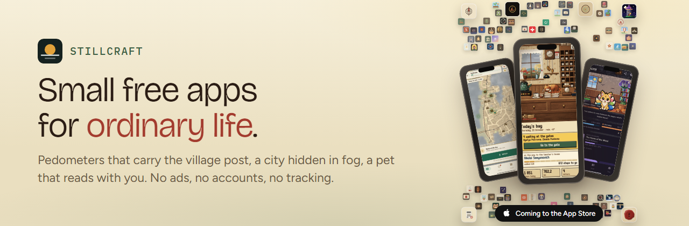

### Hi, I'm Marat 👋

I make **[Stillcraft](https://bigdevwhale.github.io/stillcraft/)** – small, calm, free apps for everyday life. Each does a few things well and gets out of the way: no ads, no accounts, no tracking, most of them work offline. Android today, iPhone next.

<table>
<tr><td width="50%" valign="top">&nbsp;<a href="https://bigdevwhale.github.io/stillcraft/apps/lipovka/"><b>Lipovka Post</b></a> &nbsp;A pedometer where your steps carry the village post, for years.</td><td width="50%" valign="top">&nbsp;<a href="https://bigdevwhale.github.io/stillcraft/apps/fogwalk/"><b>Fogwalk</b></a> &nbsp;Your city, hidden in mist. Walk to reveal it.</td></tr>
<tr><td width="50%" valign="top">&nbsp;<a href="https://bigdevwhale.github.io/stillcraft/apps/familiar/"><b>Familiar</b></a> &nbsp;A pixel-art familiar that feeds on the pages you read.</td><td width="50%" valign="top">&nbsp;<a href="https://bigdevwhale.github.io/stillcraft/apps/farwalker/"><b>Farwalker</b></a> &nbsp;Walk round the real world: every border a stamp.</td></tr>
<tr><td width="50%" valign="top">&nbsp;<a href="https://bigdevwhale.github.io/stillcraft/apps/hearthspell/"><b>Hearthspell</b></a> &nbsp;Chores as spells in a cosy wizard's tower.</td><td width="50%" valign="top">&nbsp;<a href="https://bigdevwhale.github.io/stillcraft/apps/heartwood/"><b>Heartwood</b></a> &nbsp;Befriend a real tree; every visit is a ring.</td></tr>
<tr><td width="50%" valign="top">&nbsp;<a href="https://bigdevwhale.github.io/stillcraft/apps/stringer/"><b>Stringer</b></a> &nbsp;Every walk is an assignment from the district paper.</td><td width="50%" valign="top">&nbsp;<a href="https://bigdevwhale.github.io/stillcraft/apps/obol/"><b>Obol</b></a> &nbsp;Earn obols with useful apps, pay Charon for the feed.</td></tr>
</table>

<a href="https://bigdevwhale.github.io/stillcraft/apps/"><b>See every app →</b></a>

### 💛 Support

All the apps are free and will stay free. Support buys time for fixes, new features, new apps and the iPhone versions people keep asking for – Lipovka Post goes first.

### Find me

[Stillcraft site](https://bigdevwhale.github.io/stillcraft/) · [Telegram community](https://t.me/+Q4gFEDk8O842OGVi) · [Blog](https://it.badykov.com/) · [Suggest an app idea](https://t.me/ArcaneWhisperBot?start=idea)

Пишу по-русски тоже: все приложения на русском и английском, а сообщество в Telegram – русскоязычное.
